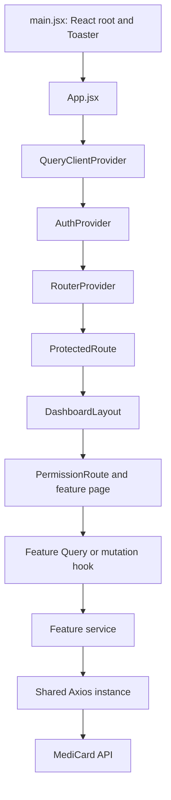

# Architecture and project structure

[README](../README.md) · [Routing](routing.md) · [API integration](api-integration.md)

## Runtime composition

[`src/main.jsx`](../src/main.jsx) mounts `App` in React Strict Mode and a React Hot Toast `Toaster`. [`src/app/App.jsx`](../src/app/App.jsx) nests `QueryClientProvider`, `AuthProvider`, `Suspense`, and `RouterProvider`. The [Query client](../src/app/queryClient.js) uses TanStack Query defaults; no global retry or stale-time policy is configured there.

The diagram shows the usual protected feature path. `/login` and `/change-password` are outside the dashboard layout; some components call services directly for lookups. See [routing](routing.md) and [authentication](authentication-and-permissions.md).

## Source layout

| Path | Responsibility |
| --- | --- |
| [`src/app/`](../src/app/App.jsx) | Provider composition, router, Query client |
| [`src/features/`](../src/features/providers/pages/ProvidersPage.jsx) | Feature-owned pages, components, hooks, schemas, services, and utilities |
| [`src/shared/api/`](../src/shared/api/axiosInstance.js) | Axios instance, token storage functions, interceptors |
| [`src/shared/components/`](../src/shared/components/QueryErrorState.jsx) | Reusable fields, modals, selects, tables, pagination, guards, states |
| [`src/shared/hooks/`](../src/shared/hooks/useServerPagination.js) | Pagination, debounce, media query, and filter panel hooks |
| [`src/shared/utils/`](../src/shared/utils/handleMutationError.js) | Error mapping, JWT, image compression, input, and dashboard filter helpers |
| [`src/layout/`](../src/layout/DashboardLayout.jsx), [`src/navbar/`](../src/navbar/Navbar.jsx), [`src/sidebar/`](../src/sidebar/Sidebar.jsx) | Dashboard shell and permission-filtered navigation |
| [`src/assets/`](../src/assets/Logo.svg), [`public/`](../public/favicon.svg) | Imported and public static assets |

Feature folders generally use `pages/`, `components/`, `hooks/`, `schema/`, and `services/`. Names and capitalization are not fully uniform: examples include `ServiceCategory`, `Medicines`, `categoreis`, `cardActivtion`, and singular `service/` directories. Use existing paths when navigating or importing; do not infer a path from a normalized feature name.

## State and data flow

- `AuthProvider` owns the in-memory token, user, permissions, initialization flags, and password-change state. Token values and the password-change flag are stored in `localStorage`; permission codes are not persisted. See [authentication](authentication-and-permissions.md).
- TanStack Query owns server data. Feature hooks define query keys and response projections; mutation hooks typically invalidate affected query keys. [`useProvidersQuery`](../src/features/providers/hooks/useProvidersQuery.js) and [`useTicketMutations`](../src/features/tickets/hooks/useTicketMutations.js) are representative examples.
- Pages and forms use local React state for open dialogs, draft filters, search terms, and editing state. [`useServerPagination`](../src/shared/hooks/useServerPagination.js) manages page number and size and resets the page when its caller's reset key changes.
- Dashboard summary and chart filters use `sessionStorage` through [`dashboardFilterSession.js`](../src/shared/utils/dashboardFilterSession.js); login, logout, and session invalidation clear them.
- Shared field and form utilities include [`TextField`](../src/shared/components/TextField.jsx), [`ImageUploadField`](../src/shared/components/ImageUploadField.jsx), [`applyServerErrors`](../src/shared/utils/applyServerErrors.js), and [`handleMutationError`](../src/shared/utils/handleMutationError.js). A shared component's existence does not mean every feature uses it.

## Styling and major libraries

[Vite configuration](../vite.config.js) loads the React and Tailwind CSS v4 plugins. [`src/index.css`](../src/index.css) holds global styles. React Router handles client navigation, React Hook Form and Zod handle many forms, Recharts renders dashboard charts, and Leaflet/React Leaflet render the map. The exact dependency versions and scripts are in [`package.json`](../package.json).

The architecture is a description of source code, not a guarantee that every backend call or UI flow succeeds in a deployed environment.
