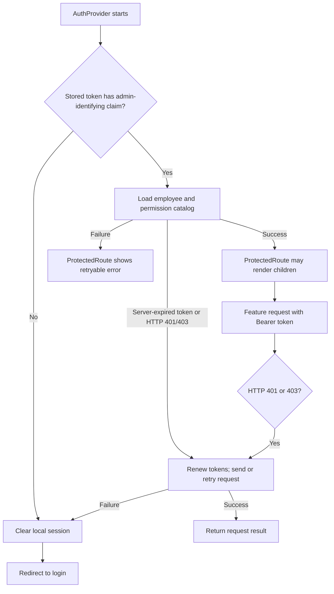

# Authentication and permissions

[README](../README.md) · [Routing](routing.md) · [API integration](api-integration.md)

This describes client behavior. The repository does not establish the backend's token validity rules or server-side authorization enforcement.

## Login and stored session

[`useAuthMutations`](../src/features/auth/hooks/useAuthMutations.js) sends `POST AuthAdmin/login` with `email` and `password`, mapping the login form's `identifier` field to `email`. The success handler reads a token from `data.token` or `data.accessToken`, `data.isNeedChangePassword`, and permission codes from `data.permissionCodes` with `data.permissions` as a fallback. It accepts `succeeded` or `success` on the outer response. The exact live response shape is backend-dependent.

[`AuthProvider`](../src/features/auth/context/Authcontext.jsx) stores the access token under `token`, the refresh token under `refreshToken`, and the password-change flag under `mustChangePassword` in browser `localStorage`. It decodes [JWT claims](../src/shared/utils/jwt.js) such as `employeeId` and `accountType` to form a user object. Decoding is a client-side convenience, not proof that the server accepts a token. Login clears old dashboard filters and legacy persisted permission keys.

The login page uses React Hook Form and the [login Zod schema](../src/features/auth/schema/loginSchema.js). It sends the validated form through the mutation hook. Credentials are never documented as values here.

## Startup, request, and session expiry

The [Axios request interceptor](../src/shared/api/axiosInstance.js) adds `Authorization: Bearer <token>` when a token exists. It rejects normal requests without a token and blocks most requests while a forced password change is required. Login and logout are treated as auth requests; change-password and logout are allowed during the password-change state.

On startup, `AuthProvider` checks the stored JWT for an admin-identifying claim, then calls `restoreAuthSession` before loading permissions. A new page has no in-memory server-clock reference, so a saved token with refresh credentials is renewed once through the existing refresh endpoint to obtain server time. Concurrent initialization calls share that operation. If no refresh credential exists, the saved session is preserved without a proactive timer until the backend rejects a protected request. A missing or malformed admin identity still clears the local session. Route guards continue to wait for initialization and permission loading.

The single `refreshAccessToken` function in [Axios](../src/shared/api/axiosInstance.js) sends `POST AuthAdmin/refresh-token` with `{ refreshToken }` using base Axios to bypass the interceptors. It reads `succeeded`, `data.success`, `data.token`, and `data.refreshToken` from the response. Valid credentials replace both stored tokens and update the provider's token state. Concurrent timer, initialization, resume, and protected-request triggers wait for the same refresh promise. A replacement session waits for an older rotation to settle; session-generation and credential-snapshot checks prevent old results or errors from restoring a logged-out session or overwriting/clearing a new login. Refresh requests have a 15-second timeout.

HTTP 401 and HTTP 403 from a non-auth request use the same recovery path: reuse an already-rotated current token when possible, otherwise share a refresh, then retry the request at most once. The existing repeated-401 propagation policy now applies to repeated 403 responses as well: the error reaches the caller without another refresh or retry. Login, refresh, and logout errors cannot recursively start recovery. The existing refresh-failure policy is retained: a missing refresh credential, any HTTP/transport failure (including timeout, network, 429, or 5xx), or an invalid refresh response clears only the matching session, synchronizes the context via its existing handler, clears Query data, and redirects to login.

[`ProtectedRoute`](../src/shared/components/Protectedroute.jsx) waits for initialization and permission loading. It checks authentication, clears Query data on invalid state, redirects to `/login` after session failure, and sends users with `mustChangePassword` to `/change-password`. On permission-loading failure it preserves the authenticated session and presents a retry action. The standalone [`SessionExpiredModal`](../src/features/auth/components/SessionExpiredModal.jsx) exists in source but is not mounted by `App` or the route tree; do not describe it as the displayed expiry flow.

## Server-time refresh scheduling

- The access JWT's numeric `exp` claim is converted from seconds to milliseconds. The existing `jwt-decode` dependency decodes claims; this does not verify signatures. Refresh tokens are opaque and are never decoded.
- The login service retains the Axios response headers. The login mutation passes the `X-Server-Local-Time` value to the existing context's token setter; refresh reads the same header from its own response.
- An in-memory reference pairs server time with `performance.now()`. Estimated server time is the reference timestamp plus elapsed monotonic time; authentication never uses the device's wall clock to schedule refreshes or reject otherwise well-formed tokens.
- A single timer targets `exp * 1000 - estimatedServerTime - 60_000`. Long delays are chunked to fit browser timer limits. A login token within the margin can refresh immediately. A newly rotated token still within the margin is kept without a zero-delay loop, leaving 401/403 recovery available.
- The authoritative source is `X-Server-Local-Time`, read case-insensitively from the actual Axios headers. The standard `Date` header is deliberately ignored. The backend exposes the custom header with `Access-Control-Expose-Headers: X-Server-Local-Time`; a header visible in DevTools may still be unreadable to JavaScript if CORS does not expose it.
- `Date.parse()` receives the complete ISO 8601 timestamp, including all fractional digits and its explicit timezone offset (or `Z`). Missing timezone information is rejected rather than interpreted in device-local time, and the parsed result must be finite. For example, `2026-10-27T11:33:41.1707425+03:00` resolves to `2026-10-27T08:33:41.170Z` at JavaScript's millisecond precision; no offsets are manually added or removed. The server clock must agree with the JWT issuer's clock. Response transit time still introduces uncertainty, so the 60-second margin is a scheduling precaution, not a validity guarantee.
- Missing, unreadable, or invalid `X-Server-Local-Time` does not invent a clock or cause logout. Without a known reference, proactive scheduling is skipped and validity is left to backend responses. A refresh in the same uninterrupted session may retain its existing reference when the custom header is missing.
- Returning to a visible tab or restoring from the back/forward cache discards the potentially suspended clock reference and obtains fresh server time through one shared refresh. An ordinary initial `pageshow` does not add a second request. If resume succeeds without readable `X-Server-Local-Time`, the session remains usable without a timer.
- Reload/resume synchronization rotates credentials through the existing endpoint; it does not introduce a time endpoint. It retains the existing failure policy above, so resuming while offline can expire the matching session. Cross-tab rotation coordination is unchanged and still depends on backend behavior.
- No expiry timestamps or clock offsets are stored in localStorage. Logout and replacement login cancel the old timer and clear its in-memory reference; logout also removes resume listeners. Permission checks, login fields, password-change behavior, and logout endpoints are preserved.

## Authentication regression tests

Run `node --test tests/auth.test.mjs` from this Admin Dashboard repository. There was no existing test script or test suite to replace. The tests use Node's built-in test runner, the installed Vite loader, generated credentials, and mocked Axios adapters; they do not contact the backend or expose real tokens. Coverage includes device clock offsets, the 60-second margin, unreadable server-time headers, fractional seconds and timezone offsets, reload/resume, 401/403 recovery, concurrency, stale responses, logout during refresh, token rotation, short/long lifetimes, and password-change restrictions.

## Password change and logout

The [forced password page](../src/features/auth/pages/ForceChangePasswordPage.jsx) hosts [`ChangePasswordModal`](../src/features/auth/components/ChangePasswordModal.jsx). That modal uses local form state and the Zod password schema. The mutation sends `currentPassword`, `newPassword`, and `confirmNewPassword` to `POST AuthAdmin/change-password`. On a successful response, the client clears its session and returns to login. The user menu also opens the modal for a voluntary password change.

Logout sends `POST AuthAdmin/logout`, then clears the local session and Query cache and redirects to login whether the request succeeds or fails. This is client behavior; backend token revocation is unverified.

## Permission resolution and use

The client does not persist permission codes. At login it normalizes codes supplied in the login response. On startup, [`AuthProvider`](../src/features/auth/context/Authcontext.jsx) fetches `GET EmployeeAdmin/{employeeId}` and `GET PermissionAdmin`, maps the employee's `permissionIds` through catalog entries with `id` and `code`, and places the resulting codes in context. Missing IDs, unresolved IDs, or a failed request produce a permission initialization error instead of granting access. Editing the current employee's permissions triggers a reload through [`useEmployeePermissionsMutation`](../src/features/employees/permissions/hooks/useEmployeePermissionsMutation.js).

[`permissionCodes.js`](../src/features/auth/constants/permissionCodes.js) contains the strings used by the UI. `hasPermission` checks exact code membership for an authenticated user. [`PermissionRoute`](../src/features/auth/components/PermissionRoute.jsx) guards pages; [`PermissionGuard`](../src/features/auth/components/PermissionGuard.jsx), [sidebar navigation](../src/sidebar/navigation.js), and feature components hide or disable specific actions. The provider details page and package tab provide examples of nested action checks. These checks describe the front-end UI only; whether the backend rejects unauthorized calls must be verified with backend owners or integration tests.
