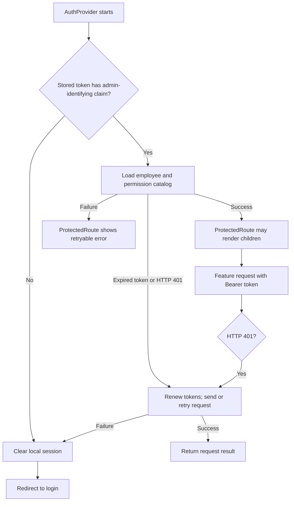

# Authentication and permissions

[README](../README.md) · [Routing](routing.md) · [API integration](api-integration.md)

This describes client behavior. The repository does not establish the backend's token validity rules or server-side authorization enforcement.

## Login and stored session

[`useAuthMutations`](../src/features/auth/hooks/useAuthMutations.js) sends `POST AuthAdmin/login` with `email` and `password`, mapping the login form's `identifier` field to `email`. The success handler reads a token from `data.token` or `data.accessToken`, `data.isNeedChangePassword`, and permission codes from `data.permissionCodes` with `data.permissions` as a fallback. It accepts `succeeded` or `success` on the outer response. The exact live response shape is backend-dependent.

[`AuthProvider`](../src/features/auth/context/Authcontext.jsx) stores the access token under `token`, the refresh token under `refreshToken`, and the password-change flag under `mustChangePassword` in browser `localStorage`. It decodes [JWT claims](../src/shared/utils/jwt.js) such as `employeeId` and `accountType` to form a user object. Decoding is a client-side convenience, not proof that the server accepts a token. Login clears old dashboard filters and legacy persisted permission keys.

The login page uses React Hook Form and the [login Zod schema](../src/features/auth/schema/loginSchema.js). It sends the validated form through the mutation hook. Credentials are never documented as values here.

## Startup, request, and session expiry

The [Axios request interceptor](../src/shared/api/axiosInstance.js) adds `Authorization: Bearer <token>` when a token exists. It rejects normal requests without a token and blocks most requests while a forced password change is required. Login and logout are treated as auth requests; change-password and logout are allowed during the password-change state.

On startup, `AuthProvider` restores a stored JWT with an admin-identifying claim and loads permissions. A missing or malformed token clears the local session. An expired token remains available for renewal: the Axios request interceptor refreshes it before sending protected requests, including the startup permission requests. Route guards allow the existing session to remain mounted during renewal.

The single `refreshAccessToken` function in [Axios](../src/shared/api/axiosInstance.js) sends `POST AuthAdmin/refresh-token` with `{ refreshToken }` using base Axios to bypass the interceptors. It reads `succeeded`, `data.success`, `data.token`, and `data.refreshToken` from the response. Valid credentials replace both stored tokens and update the provider's token state. Concurrent requests wait for the same refresh promise.

An HTTP 401 from a non-auth request renews the current token and retries the request once. A delayed 401 sent with an older token reuses the renewed token. A second 401 is returned to the caller without another retry. Login and logout errors are left to their existing mutation handlers. A missing refresh token, rejected refresh, or invalid refresh response clears the session and Query data and redirects to login. Responses from a previous login cannot overwrite the current session.

[`ProtectedRoute`](../src/shared/components/Protectedroute.jsx) waits for initialization and permission loading. It checks authentication, clears Query data on invalid state, redirects to `/login` after session failure, and sends users with `mustChangePassword` to `/change-password`. On permission-loading failure it preserves the authenticated session and presents a retry action. The standalone [`SessionExpiredModal`](../src/features/auth/components/SessionExpiredModal.jsx) exists in source but is not mounted by `App` or the route tree; do not describe it as the displayed expiry flow.

## Password change and logout

The [forced password page](../src/features/auth/pages/ForceChangePasswordPage.jsx) hosts [`ChangePasswordModal`](../src/features/auth/components/ChangePasswordModal.jsx). That modal uses local form state and the Zod password schema. The mutation sends `currentPassword`, `newPassword`, and `confirmNewPassword` to `POST AuthAdmin/change-password`. On a successful response, the client clears its session and returns to login. The user menu also opens the modal for a voluntary password change.

Logout sends `POST AuthAdmin/logout`, then clears the local session and Query cache and redirects to login whether the request succeeds or fails. This is client behavior; backend token revocation is unverified.

## Permission resolution and use

The client does not persist permission codes. At login it normalizes codes supplied in the login response. On startup, [`AuthProvider`](../src/features/auth/context/Authcontext.jsx) fetches `GET EmployeeAdmin/{employeeId}` and `GET PermissionAdmin`, maps the employee's `permissionIds` through catalog entries with `id` and `code`, and places the resulting codes in context. Missing IDs, unresolved IDs, or a failed request produce a permission initialization error instead of granting access. Editing the current employee's permissions triggers a reload through [`useEmployeePermissionsMutation`](../src/features/employees/permissions/hooks/useEmployeePermissionsMutation.js).

[`permissionCodes.js`](../src/features/auth/constants/permissionCodes.js) contains the strings used by the UI. `hasPermission` checks exact code membership for an authenticated user. [`PermissionRoute`](../src/features/auth/components/PermissionRoute.jsx) guards pages; [`PermissionGuard`](../src/features/auth/components/PermissionGuard.jsx), [sidebar navigation](../src/sidebar/navigation.js), and feature components hide or disable specific actions. The provider details page and package tab provide examples of nested action checks. These checks describe the front-end UI only; whether the backend rejects unauthorized calls must be verified with backend owners or integration tests.
